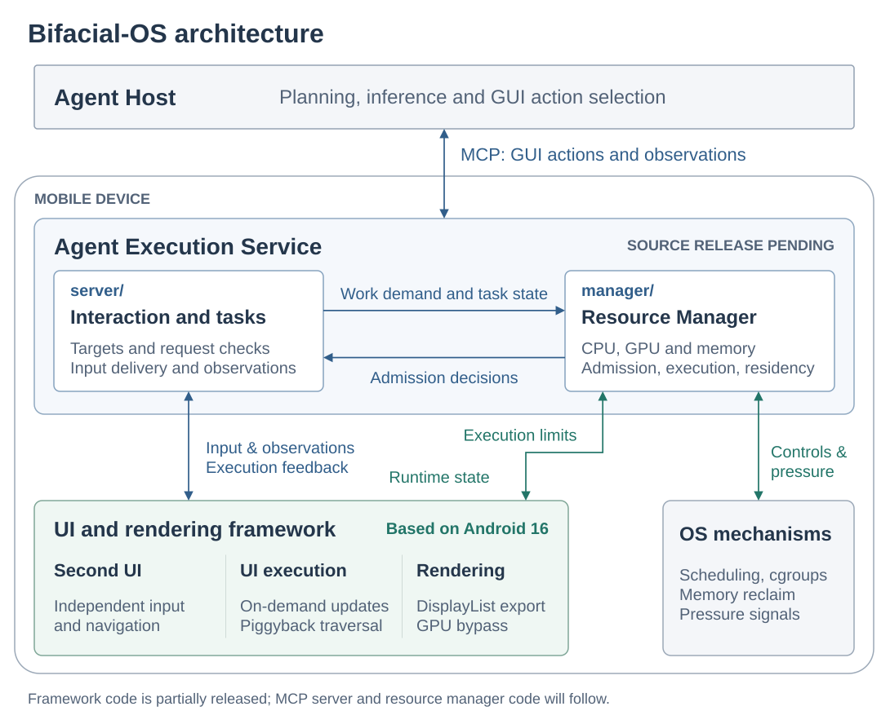

# Bifacial-OS

Bifacial-OS provides system-level support for GUI agents on mobile devices. It combines a device-side **MCP server** for application interaction, **foreground-aware resource control**, and **framework-level optimizations** for GUI-agent task execution.

The current release includes part of the framework implementation as patches to Android's `frameworks/base` and `frameworks/native`. The remaining code, including the MCP server and resource manager, will be open-sourced later.

## Architecture

The device-side **Agent Execution Service** exposes GUI actions and observations through MCP. Its internal **Resource Manager** uses foreground pressure, application sharing, and actual work in flight to control execution. Framework extensions implement the UI and rendering mechanisms.

[Editable draw.io source](assets/architecture.drawio) · [PDF](assets/architecture.pdf)

GUI input still reaches the application's UI callbacks and existing business logic. Shared-business coordination belongs inside the application execution path; application business methods are not exposed as direct agent commands. Resource decisions run inside the service rather than requiring the model to request CPU or memory changes.

## Components and current contents

| Directory | Role in the system | Included now |
| --- | --- | --- |
| [server/](server/README.md) | Provides the MCP interface and coordinates agent interaction with mobile applications | Component documentation; source code pending release |
| [manager/](manager/README.md) | Manages agent resource use to preserve foreground responsiveness | Component documentation; source code pending release |
| [framework/](framework/README.md) | Supports independent agent interaction with applications and improves GUI-task execution efficiency | Base/native patches, minimal usage examples, fixed source versions and porting guidance |

`server/` and `manager/` are separate source modules; the manager is an internal component of the Agent Execution Service. The directory split does not require two independently deployed services.

The framework snapshot includes UI construction and rendering controls that support independent user and agent interaction within the same application and reduce unnecessary UI updates and rendering work. The control mechanism for requests submitted between application layers is **pending release** and is not included now in this repository.

## Getting started

1. Read the [framework README](framework/README.md) for the exact AOSP baseline, development branches and included commits.
2. Apply the patches to compatible source trees and build them for the target device.
3. Follow the [minimal framework examples](framework/examples/README.md) to create an agent display, inject input, control rendering and export raw DisplayList observations.

This snapshot is a source-level integration starting point. It does not contain an installable end-to-end service or a device image. Screenshot and DisplayList observations are independent of whether a second UI instance is needed; Piggyback specifically addresses a shared application main thread.

## Experiment scripts

This repository includes [two minimal framework examples](framework/examples/README.md) with build, invocation and cleanup instructions. They use the bundled framework patches and require no model credentials. The full experiment suite, datasets and observation-processing pipeline are not included in this release.

## Version compatibility and AI-assisted reproduction

Reproducing system software requires pinning the source branches, exact commits and platform versions. The supplied patches target the revisions listed in the [framework README](framework/README.md) and may not apply directly to other branches or versions. Developers targeting a different version must implement the necessary adaptations in their own source tree and validate the resulting build on the target device.

AI coding assistants such as Codex and Claude can substantially help with understanding the code hierarchy and dependencies, locating equivalent implementation points across versions, and carrying out the adaptation and reproduction process. Provide the assistant with the component documentation, pinned source revisions, patches and target platform code, and use it to assist with implementation, build troubleshooting and functional validation.
